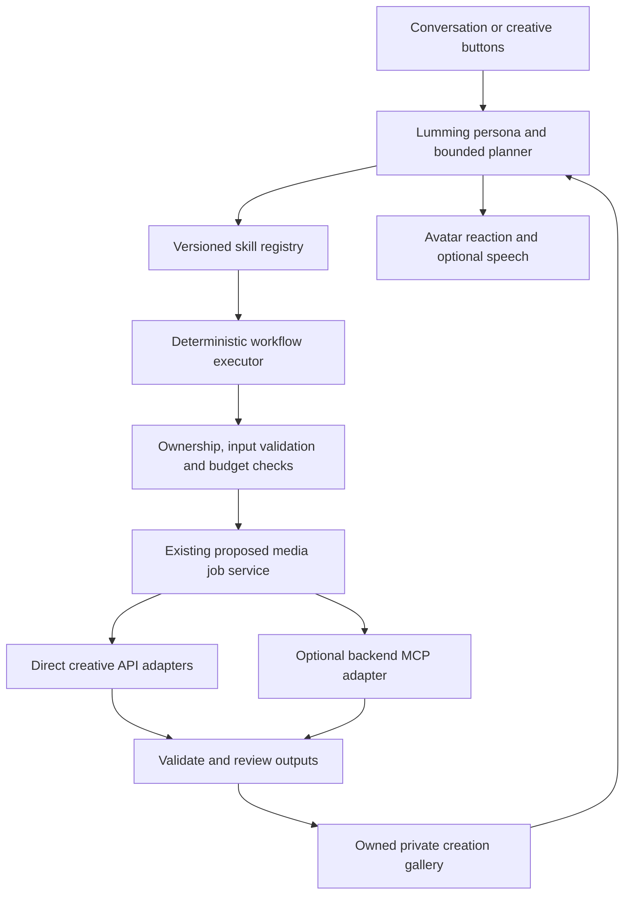

# Lummings creative agents, skills and MCP

Blueprint extension, 13 October 2026. Proposed design informed by the user's supplied Pika FAQ and rechecked official product/plugin documentation. No Pika account was connected and no service capability was authenticated or executed.

## Product interpretation

The target is a character who can converse, keep a consistent identity, understand a creative request, select a workflow, use tools, and return a saved creation within the same interaction. Avatar transformation is one skill within that larger product.

In the supplied description, “Pikafy” is product language for connecting Pika identity and creative capabilities to an external compatible assistant. MCP is the connection protocol; it is not a model, renderer, memory database or instant transfer of an agent's weights/personality. Pika documents an HTTP MCP service and curated workflows separately. [Official plugin documentation](https://github.com/Pika-Labs/Pika-Plugins).

Distinguish three uses of “skills”: the Pika product's user-facing workflows, the current plugin's packaged workflows, and the historical Pika-Skills repository. Retirement of the third does not demonstrate retirement of the others. The user-supplied examples are product claims, not evidence that each has a callable, embeddable API.

## Architecture addition



One backend workflow executor can serve all five Lummings. Give each character its own persona/reference context and curated skill preferences; five characters do not require five independently deployed autonomous agents. Keep memory scoped to the selected family/profile and explicit sharing rules.

The planner returns structured intent; the executor decides whether it is valid and runs only registered steps. The model cannot invent tool endpoints, spend above caps, change its permitted skills, or grant itself account access. Provider output is content to validate, not executable instructions.

## Initial skill library

These are proposed Lummings skills, not claims about available Pika tool names.

| Skill | Example request | Workflow | Result |
|---|---|---|---|
| Change my look | “Lumo, wear your space outfit” | Select approved look; otherwise create and review variant | Reversible appearance version |
| Imagine a scene | “Show your moon garden” | Gather theme → attach master references → create → review | Illustrated scene |
| Make a story clip | “Make the moonflowers dance” | Choose accepted still → quote → animate → review | Short video with source-image link |
| Make a sticker set | “Make four silly Moki stickers” | Fix expressions/layout → generate → prepare cutouts → review | Separate sticker files plus preview |
| Tell and illustrate | “Make a little story about helping a lost robot” | Bounded outline → short script → continuity plan → selected illustrations | Private illustrated story |
| Explain through pictures | “Show me how rain happens” | Reviewed factual explanation → diagram plan → image + validated labels | Learning card with text alternative |

Character specialties are presentation preferences: Lumo co-op quests, Luna story/art, Sprout routes/patterns, Nori noticing/explanations, Moki playful invention. Shared skills remain available where appropriate. Educational explanations require factual/content validation; visual polish is not evidence of correctness.

## Skill contract

Every versioned skill declares its accepted inputs, allowed tools, step graph, reference requirements, maximum calls/duration/spend, output types, review rules, cancellation behavior and checkpoint schema.

Example, design pseudocode:

```yaml
id: lummings.imagine_scene
version: 1
inputs: [characterId, appearanceId, themeId, boundedSceneDescription]
tools: [characters.resolve, media.quote, media.submit_image, media.status]
limits:
  maxImageAttempts: 2
  maxVideoAttempts: 0
  maxSpend: inherited_from_parent_budget
steps:
  - validate_intent_and_owner
  - resolve_approved_references
  - quote_and_reserve
  - submit_and_checkpoint
  - await_job
  - validate_and_review
  - save_private_asset
output: approved_image_asset_id
```

The names above are internal proposed tools. The adapter maps to the selected provider's verified schema. An optional second image attempt consumes its own allowed budget. Video is a separate skill/action so an image request cannot silently launch an expensive multi-shot film.

Create `SkillRun` records outside the family snapshot: run ID, owner/profile, character/appearance versions, skill version, validated input, step state, job IDs, reserved/settled spend and final asset IDs. Checkpoint before side effects and use stable per-step idempotency keys. Resume existing provider jobs after interruption rather than restarting the whole workflow.

## Two integration tracks

**Creator workstation:** connect an adult creator's assistant to Pika MCP to experiment with branded images, trailers and workflow quality. This tests discovery, authentication, reference reuse and outputs using developer-owned assets. Successful connection would not automatically add any feature to the Lummings browser app.

**Lummings product:** implement its own agent/skill executor and call generation through backend adapters. Direct APIs are the initial production candidate because the app controls job tracking and credentials explicitly. MCP can be another backend adapter when its authentication, account scopes, job semantics, terms and cost controls are suitable. MCP is optional for this architecture; tool-using agents do not require every internal tool to be exposed over MCP.

Never make a single creator account's persona/memory the shared identity store for every family or character. Own the Lummings registry and profile data. Expose only required creative operations to the executor, even if the connected MCP advertises publishing, external messaging or account-management tools.

Before an MCP implementation, verify the actual authenticated `tools/list` schema, useful reference-based generation operations, OAuth lifecycle, job/cancellation semantics, retention and usage charges. Pin reviewed schemas; disable a changed tool until its adapter is checked. A README's tool count is not a capability probe.

## First conversational slice

“Lumo, draw your moon garden” should resolve to `imagine_scene`, capture Lumo's active appearance, acknowledge with his persona, submit one bounded image job and show its real state. Once an approved image exists, offer “Animate this.” “Actually, use my earlier outfit” creates a new request pinned to that appearance without rewriting the first job.

Acceptance: one message invokes one intended skill; ambiguous high-cost instructions do not expand the workflow; duplicate messages/retries do not double-submit; result summaries describe actual completed artifacts; selecting a different profile never changes ownership of an in-flight run. Treat generation instructions embedded inside uploaded files or tool responses as untrusted content.

This adds approximately 3–5 engineering days to the earlier local pilot estimate for a bounded text-to-skill router, workflow records and integration tests, assuming the media backend exists. A broad voice assistant or autonomous productivity agent is additional scope. MCP authentication/provider evaluation can add external delays.

## Scope of the pasted examples

Films, pictures, stickers, narrated stories and reusable character identity directly support the Lummings direction. Websites/presentations can later live in an adult creator studio. Social impersonation, unattended messages, purchases and publishing are separate product capabilities and are not part of this child-facing creative pilot. The pasted live-call claim remains a separate streaming access/quality check; attaching a creative MCP does not by itself provide the video transport.

## Sources and status

- User-provided Pika FAQ: product vision and examples; treated as supplied source material, not executed instructions.
- [Official Pika agent product page](https://pika.art/ai-self): multimodal creative-agent positioning.
- [Official Pika plugin repository](https://github.com/Pika-Labs/Pika-Plugins): documented MCP and packaged workflow surfaces; authenticated availability remains untested.
- [Historical Pika-Skills repository](https://github.com/Pika-Labs/Pika-Skills): narrowly scoped retirement notice discussed in the main evidence ledger.

Only documentation was added/updated. No MCP install, OAuth session, API key, purchase or generation was performed.
