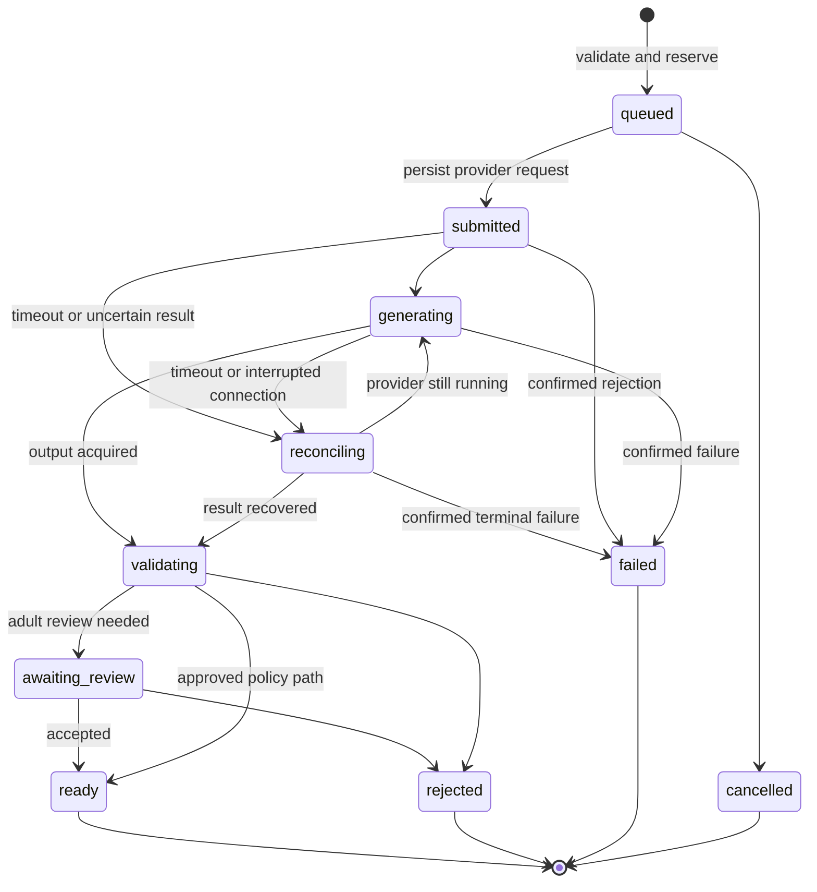

# Proposed contracts and integration map

Status: design only. Paths, Lummings routes and types below are proposed additions, not existing APIs. See [blueprint](README.md).

## Files to add when implementation begins

```text
src/lummings/media/
  service.py                authorization, quotes, quotas, job creation
  repository.py             SQLite jobs/assets/appearance versions
  worker.py                 durable leases, retries, recovery, polling
  character_registry.py     public IDs, legacy aliases, master references
  prompt_compiler.py        bounded intent to provider-specific inputs
  validation.py             input/output checks, review decisions
  providers/base.py         capability contract
  providers/pika_api.py     current direct creative API adapter
  providers/fal_api.py      independent image/video adapter
docs/companion/
  avatar-stage.js            prepared states, appearance transitions
  creation-client.js         requests, job cards, reconnect handling
brand/characters/            versioned reference manifests; no family data
data/media/
  media.sqlite3             local job, reference, cost and review metadata
  assets/                   generated private files by opaque asset ID
  quarantine/               unreviewed results, never static-served
tests/                      isolated media and browser contract tests
```

Add `data/media/` to local-data ignore rules before writing private output. Do not put generated family content under `docs/`, the public GitHub Pages tree, or Git. Do not reserialize the whole family state on every job update. Existing `family_server.py` can route into the media service for a local pilot; public deployment requires a separate authenticated gateway.

The current family schema is version 1, with a strict character enumeration and a 1 MB request-body limit. If appearance/asset pointers are added to profiles, implement a versioned migration with a pre-migration backup and backward-compatible reads. Preserve existing character IDs and optimistic revision checks. Never embed base64 media in the family payload. Extend export with an asset manifest and an optional media bundle; a JSON list of external URLs alone is not a recoverable export. Validate a restore into a separate temporary directory before promising media recovery.

## Domain records

| Record | Required fields and invariants |
|---|---|
| CharacterVersion | publicCharacterId, personaId, version, masterAssetIds, invariantTraits, permittedChanges, voiceId, rightsRecord; immutable after approval |
| AppearanceVersion | id, ownerScope, characterVersion, baseAppearanceId, assetIds, selectedOptions, reviewStatus; active selection uses compare-and-swap |
| GenerationJob | id, ownerScope, profileId, characterVersion, appearanceVersion, kind, requestHash, clientIdempotencyKey, provider, modelVersion, providerRequestId, state, attempt, timestamps, lease, errorCode |
| Asset | id, ownerScope, jobId, sourceAssetIds, SHA256, MIME, bytes, dimensions, duration, privatePath, reviewStatus, retentionState |
| CostEntry | jobId, attempt, currency, reservedMicrousd, settledMicrousd, quoteId/version, billingState; settle exactly once per provider job |
| ConsentVersion | ownerScope, mode, provider, disclosedDataClasses, version, enabledAt, revokedAt; check again before dispatch |

Owner scope is one trusted local installation for the developer pilot, with profile separation for organization. For public hosting it must derive from authenticated family membership. A browser-provided profile ID is never proof of ownership. Cache keys include owner scope, master hashes, appearance version, prompt template, model/settings and policy version.

Illustrative bounded intent, generated by buttons first and optionally by an LLM later:

```json
{
  "action": "create_scene",
  "characterId": "lumo",
  "characterVersion": "lumo-ruby-v1",
  "appearanceId": "lumo-explorer-v1",
  "theme": "moon-garden",
  "pose": "pointing",
  "style": "approved-storybook",
  "output": {"kind": "image", "aspectRatio": "1:1"}
}
```

Example IDs are proposed labels. Resolve actual reference file paths and hashes before generating. The server rejects unknown fields/options and compiles the real prompt using trusted templates. Full child dialogue and persona memory are not media-provider input.

## Lummings API surface

| Proposed route | Behavior |
|---|---|
| `GET /api/media/capabilities` | Enabled actions, limits and availability; no provider credentials |
| `GET /api/media/characters/{id}` | Approved appearances and public character manifest |
| `POST /api/media/quotes` | Validate intent and ownership; return expiring estimate and allowed options |
| `POST /api/media/jobs` | Quote + bounded intent + idempotency key; atomically reserve funds and persist job; return 202 |
| `GET /api/media/jobs/{id}` | Owned job status and approved result IDs; no raw provider error payload |
| `POST /api/media/jobs/{id}/cancel` | Mark discard/cancel intent; attempt provider cancellation only if supported |
| `GET /api/media/assets/{id}` | Authorize read and serve verified media, or short-lived owned download URL |
| `POST /api/media/appearances/{id}/apply` | Require accepted asset plus expected current version; return 409 on stale update |
| `DELETE /api/media/assets/{id}` | Tombstone, invalidate derivatives and queue actual deletion according to disclosed retention |
| `POST /api/media/reviews/{id}` | Adult acceptance/rejection; retain audit metadata without sensitive prompt logs |

Use exact routes, method restrictions, content limits and safe MIME handling. For local use retain Host/Origin checks and local token discipline. For hosted use require authenticated family authorization, CSRF protection where cookie-based, and per-tenant rate limits. Never accept arbitrary upstream URL/model from the browser. Asset fetches must constrain schemes/hosts, redirects, byte limits and file signatures; prevent internal-network requests.

## Job lifecycle



`cancelRequested` and `discardResult` are independent flags for submitted/running jobs. A local cancellation does not prove the provider stopped or refunded generation. Keep reconciling costs even when the user no longer wants the result. Profile erasure tombstones the scope so a late result cannot restore deleted content.

Persist the request intent before network submission. Reuse the same provider idempotency key for an uncertain transport outcome; query the prior request first where possible. A new creative attempt gets a new attempt ID, reservation and key only after the prior outcome is understood. If the provider cannot make submission idempotent, do not automatically resubmit ambiguous calls.

Worker leases prevent two processes claiming the same job. Bound concurrency and retries; honor Retry-After and use jitter. Resume queued and reconciling jobs after restart. Use compare-and-swap to prevent late outfit results from replacing a newer selected appearance. Provider completion means generation finished, not that validation or cost settlement finished.

Local pilot: polling avoids exposing a webhook listener. Hosted phase: verify callback signatures/timestamps, deduplicate events, and retrieve authoritative job state. Late/duplicate callbacks cannot regress terminal state or activate rejected assets. The browser can poll every few seconds with backoff and recover after reload; no tight frontend polling loop.

## Provider interface

```python
class MediaProvider:
    def capabilities(self): ...
    def quote(self, request): ...
    def submit(self, request, idempotency_key): ...
    def status(self, provider_request_id): ...
    def result(self, provider_request_id): ...
    def cancel(self, provider_request_id): ...  # optional capability
    def delete(self, provider_asset_id): ...   # optional capability
```

These are pseudocode signatures, not runnable SDK code. Adapters report supported dimensions/durations/reference counts, commercial/data eligibility and cancellation/deletion capabilities. UI actions are enabled from that contract; never assume providers behave identically.

Verified direct Pika documentation names these endpoints:

```text
GET  https://api.dev.pika.art/catalog/apis
POST https://api.dev.pika.art/v1/media/pika/pika-2.5/image-to-video
GET  https://api.dev.pika.art/v1/media/jobs/{request_id}
```

The documented five-second request uses `image`, `prompt`, `duration_s: 5`, `resolution: "720p"`. Authenticate server-side using `PIKA_API_KEY`; obtain a current quote and validate the operation's live schema first. Treat the HTTP result and job status separately because a response can contain a failed job. Billing may settle later. No paid endpoint was called for this blueprint. [Operation source](https://dev.pika.art/llms/pika/pika-2.5/image-to-video).

The fal adapter uses its documented submit/status/result workflow and the separate model schemas. It must not reuse Pika-direct request field names blindly. [fal queue reference](https://fal.ai/docs/documentation/model-apis/inference/queue).

## Storage, deletion and observability

Copy provider results into owned storage before marking them ready; verify MIME, decode, dimensions, duration, checksum and size. Never trust a provider URL as permanent archival storage. Serve raster images and verified video; do not execute generated HTML or SVG. For private downloads use attachment headers where appropriate.

Retain job timing, model version, policy outcome, reference hashes and settled spend. Redact prompts, names, signed URLs and tokens from ordinary logs. Measure queue wait separately from generation, checking and download time. Track p50/p95 latency, accepted-output rate, character drift, effective cost per accepted asset, cancellation settlement and deletion completion.

Default proposed retention: failed/quarantined media 24 hours, operational metadata 30 days, accepted creations until user deletion, subject to disclosed backup/provider constraints. Final policy must be approved before a family pilot. “Reset active family” currently preserves recovery snapshots; adding media requires a distinct erasure design and explicit backup expiry behavior.
