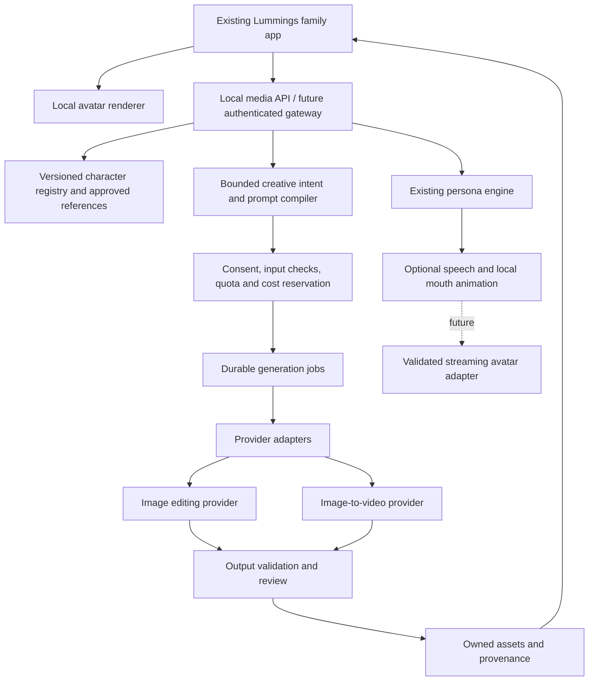

# Lummings living avatars and creative studio — build blueprint

> **Current planning entry point (15 October 2026): [Living Lummings master blueprint](../living-lummings/README.md).** It incorporates the latest Lummings app, Pixel 647cb05, the full creative-agent direction, voice, crew projects and live-avatar research. This earlier blueprint remains historical; follow the new package where sequencing or integration assumptions differ.

Prepared 13 October 2026. Status: proposed implementation, grounded in inspected project code and public provider documentation. No paid generations, installations, deployment, or application changes were performed for this blueprint.

## Decision

Build a Lummings-owned character system with three rendering paths: immediate local animation, queued image/video creation, and an optional future live generative avatar adapter. Keep personality, reference artwork, appearance history, family data, and generated assets in Lummings. Rent generation through a replaceable provider interface.

This produces the experience you want: “Lumo, put on your explorer outfit,” “Show us your moon garden,” and “Make a little movie of that adventure.” It does not require training a foundation video model.

**First deliverable:** ruby-red Lumo reacts immediately, changes between approved looks, generates a new scene from his reference artwork, animates the approved scene into a five-second clip, and saves it in the active profile's creative studio. New generated images become appearance candidates; they never silently replace the master character.

Read alongside [implementation contracts](CONTRACTS.md), [delivery backlog and acceptance gates](DELIVERY.md), and [research evidence and unresolved questions](SOURCES.md).

**Expanded direction following the supplied Pika product description:** each Lumming should be a conversational creative agent with a curated skill library. See [creative agents, skills and MCP](AGENTS-AND-SKILLS.md) for the orchestration layer above the media services. The first bounded conversational skill is “make a scene, then optionally animate it”; broad freeform dialogue remains a later expansion.

## What Pika provides, and what we must build

| Capability | Public evidence | Lummings approach |
|---|---|---|
| Persistent persona, avatar, voice and creative tools | Pika's product and plugin material describe these capabilities | Reuse Lummings personalities; own our identity and data model |
| On-demand image editing and video creation | Current Pika creative API documents asynchronous media operations | Server-side provider adapter; durable job queue; owned output storage |
| A face changing during a live conversation | PikaStream research describes reference updates during streaming | Optional research track; require an accessible streaming API and creature-quality benchmark |
| Installable public integration code | Pika-Plugins and Pika-Experiments contain integrations/examples | Study orchestration patterns; retain applicable notices if reusing code |
| A downloadable complete Pika.me platform/model | Not established by the inspected repositories | Do not plan around obtaining the platform or model weights |

The old Pika-Skills README says its developer API is discontinued. The new creative API explicitly distinguishes its asynchronous media generation from live video inference. Consequently, a working clip endpoint is not proof of an embeddable PikaStream session. [Current API index](https://dev.pika.art/llms.txt), [retirement notice](https://github.com/Pika-Labs/Pika-Skills), [PikaStream research](https://pika.art/blog/introducing-real-time-video-chat).

This retirement concerns that specific GitHub integration and its old API. It does not establish that Pika's in-product Skills or the separately documented Pika MCP service are retired. Product access, MCP connectivity, creative API access and streaming embedding must be verified separately.

## Existing Lummings foundation

Verified by source inspection, not by running the app or model services in this task:

| Existing file | What is there | Integration decision |
|---|---|---|
| `docs/companion/index.html`, `family-app.js` | Family views, My Lumming, Creative studio and parent dashboard | Add appearance controls and generation cards to these views |
| `docs/companion/project-store.js` | Reads `/api/family`, writes with revision and local token, imports old browser saves | Preserve current family flow; keep media binary files outside the family JSON |
| `src/lummings/family_server.py` | Loopback server, project SQLite, recovery snapshots and exports, Host/Origin checks | Keep local app operational; add a separate media module and database |
| `src/lummings/engine.py` | Persona prompts, mood and persistent memory helpers | Reuse character behavior; add a bounded creative intent layer |
| `src/lummings/server.py` | Separate conversation playground, including request-selected upstream URL | Keep experimental; do not use its existing handler as the public cloud gateway |
| `src/lummings/artwork.py`, `sprites.py`, `brand/` | Character visuals, traits and approved creative direction | Start with these assets and register exact masters/hashes |

Current browser IDs are `lumo`, `luna`, `sprout`, `nori`, `moki`; the Python engine maps `luna → lila`, `sprout → pip`. Store public IDs once and resolve legacy persona IDs through a shared mapping. Some older brand documents still use the retired names Lila/Pip. Preserve the mapping instead of generating duplicate characters.

Lumo's current direction is ruby-red fur, burgundy/coral quiff, amber eyes, midnight gamer clothing, cyan details and a captain brooch. Older yellow-Lumo notes are not the visual source of truth.

Source drift found: the README and browser release notes describe an earlier static/localStorage configuration. The current family app loads `project-store.js` and calls the local project server. Also, “all AI local/no data leaves” claims need mode-specific wording before cloud creation ships. These are documentation reconciliation tasks, not changes made here.

## The actual user experience

1. **My Lumming:** choose a character; see idle, listening, thinking, speaking and celebrating states. Reduced-motion mode uses static states. Mood represents the fictional character's behavior, not a diagnosis of the child.
2. **Change look:** choose an approved outfit, prop or background. A prepared asset appears immediately. “Create a new look” starts a separate image job and leaves the current character visible.
3. **Make a scene:** select a story theme and bounded creative instructions. The character acknowledges the request; an honest waiting card shows queued/generating/checking status.
4. **Bring it to life:** animate an accepted scene as a five-second clip. Video requires its own budget check and job; it is not automatically triggered by every image.
5. **Keep or undo:** approved results go into a private creation gallery. Applying a look is explicit, versioned and reversible. A saved full scene can be a portrait card but is not automatically a reusable animation rig.
6. **Continue playing:** story reading, familiar avatar reactions and previously saved media continue when the generator is slow or unavailable. Whether those files are available offline depends on their actual local storage/download status.

Example: “Lumo, become a moon explorer and show me your garden.” A local explorer look appears if available. The media service creates a reference-conditioned illustration of Lumo in a moon garden. After validation and acceptance, “Animate this” produces a short clip. His persona, voice and approved memories remain unchanged throughout.

## Three meanings of “on the fly”

| Path | Mechanism | Planning target, not measured performance |
|---|---|---|
| Instant interaction | Local SVG/layer animation, prepared poses, outfit layers, Heartlight | Cached state change p95 below 150 ms; 30 fps on chosen target device |
| New image | Reference-based image editing/generation via backend | Early benchmark target p50 ≤15 s, p95 ≤45 s |
| New story clip | Image-to-video job, validation and local save | Early benchmark target p50 ≤60 s, p95 ≤180 s |
| Continuous generative avatar | Audio-conditioned video stream with reference updates | Separate benchmark and access gate; no shipping promise |

If provider latency misses these targets, use prepared looks and scheduled creation; do not label pre-rendered or queued output “live generated video.” Do not invent progress percentages from elapsed time.

Pika reports a roughly 1.5-second speech-to-video pipeline, 24 fps and 480p on an H100 for PikaStream. Those are vendor research/deployment claims, not a benchmark on this machine or a guarantee for Lummings creatures. A decoder's memory figure is not the memory required for the whole model. [Pika's technical report](https://pika.art/blog/introducing-real-time-video-chat).

## Architecture

**Keep the current JavaScript browser app and Python backend.** No React rewrite, Kubernetes cluster or model training is needed for the first slice. Suggested implementation: a Python `media/` package, SQLite job/asset tables, a single recoverable worker, server-side HTTP provider calls, and browser polling. Adopt a framework only if public hosting complexity justifies it.

For a later hosted family service, use an authenticated API, tenant-scoped relational database, durable worker queue and private object storage. Migrate through repository/provider interfaces. The current local token protects the loopback workflow; it is not a multi-family authentication system. Do not expose it through a public tunnel as the hosted product.

## Character continuity and transformations

Create a versioned **Character DNA** record per public character:

- Stable identity: silhouette, face proportions, fur/skin palette, signature mark, art style, persona ID and voice ID.
- Master references: approved front/three-quarter/full-body images, expression sheet where available, file hashes, ownership/provenance and reviewer.
- Mutable appearance: outfit, accessory, scene, pose, expression and lighting from approved presets or reviewed generated variants.
- Constraints: which features may be covered or changed, age-appropriate presentation, and prohibited identity drift.

Every request includes a master reference. Optional latest-look references supplement it; they never replace the master. Always regenerating from the last generated image compounds drift. Seeds help repeat a request only within a provider/model's supported behavior; they are not a character identity guarantee.

Image workflow: compile bounded scene instructions → attach approved references → generate candidate → check file and content → check character resemblance → accept/reject → create immutable appearance version. Creature identity checks need silhouette, palette, accessories and human visual evaluation; human face-recognition scores alone are inappropriate.

Video workflow: start from an approved still → request a simple action with restrained camera movement → inspect temporal identity and anatomy → save as a clip linked to that still. Multiple shots should share masters and an explicit scene plan; do not expect one text prompt to guarantee continuity.

Generated 2D pictures do not contain bones, mouth shapes or garment layers. For reusable instant animation, make a small authored rig/pose set. Initially display new looks as portrait cards or pre-rendered loops; promoting a generated outfit to a rigged wearable requires segmentation, alignment and artist QA. A future 3D pipeline is a separate asset-production project.

Keep appearance and relationship memory separate. An explorer outfit does not rewrite Lumo's identity, personality or learning history. An LLM can request a permitted creative action; it cannot update consent, credits, provider configuration or identity invariants.

## Provider selection

| Option | Role | Decision |
|---|---|---|
| Pika creative API | Current documented asynchronous image/video catalogue; native Pika model route available | Preferred Pika-native integration candidate after account/terms and paid smoke test |
| fal image editing + Pika image-to-video | Public model schemas and queue workflow | Concrete independent adapter and cost baseline; benchmark before choosing production default |
| Pika MCP / Pika-Plugins | Creator workflows, references, persona/media tools | Useful adult creator workstation experiment; not the child app's broad tool surface |
| PikaStream | Continuous generated avatar | Keep disabled until current SDK/access, commercial embedding, creature support and session costs are verified |
| Local inference | Future offline image generation experiments | Keep behind same interface; inspect actual GPU/VRAM and model licence before selecting hardware/model |

The new Pika [API discovery index](https://dev.pika.art/llms.txt) and [Pika 2.5 operation specification](https://dev.pika.art/llms/pika/pika-2.5/image-to-video) document a direct integration. The independent baseline is [FLUX.2 image editing](https://fal.ai/models/fal-ai/flux-2/edit) followed by [Pika 2.2 image-to-video](https://fal.ai/models/fal-ai/pika/v2.2/image-to-video). Pin model IDs, schema snapshots and quote metadata at integration time.

The Pika plugin's account-level avatar is not a substitute for our five-character registry. Its public avatar-setting description includes face validation and a one-time-set conflict, so do not assume it accepts nonhuman Lummings or acts as an arbitrary wardrobe-switch API. Use reference-conditioned creative generation. [Plugin manifest](https://github.com/Pika-Labs/Pika-Plugins/blob/main/tools-manifest.json).

If evaluating live avatars, require a real streaming session protocol, audio input format, interruption support, timestamped audio/video, reference-update semantics, reconnect/timeout behavior, ephemeral client credentials, maximum concurrency and per-minute pricing. If any are missing, keep local animation plus optional speech as the usable fallback.

## Local and cloud modes

| Mode | Data flow | Product behavior |
|---|---|---|
| Local authored mode | Existing family data and bundled assets stay local | Stories, saved creations and prepared avatar changes |
| Optional cloud creative mode | Minimum approved character art and sanitized creative brief sent to selected vendor | New images and videos; clearly labelled before enabling |
| Future local generative mode | Prompts/assets processed on a verified local inference host | Availability and speed depend on measured hardware/model behavior |

Cloud mode is a product decision because current materials promise local operation. Default it off. An adult enables it, sees the provider/data description and controls spending. Start the technical pilot using developer-owned fictional characters and synthetic prompts. No child photographs, child voice cloning, full conversation history, school details or real names are needed for the intended feature.

This is an engineering boundary, not a legal compliance conclusion. Family-product provider eligibility, data retention, commercial rights and applicable child-data requirements must be confirmed before a family pilot. Consumer Pika account eligibility is not evidence that its API permits the intended downstream audience.

Media moderation is separate from character matching. Validate both input and output; hold uncertain output for adult review. A live stream cannot be fully reviewed before playback like a finished clip, so realtime generation requires a separate content-control assessment. A working safety filter is not a reason to expose arbitrary agent tools, web browsing or publishing to the child workflow.

Deletion must cover active assets, thumbnails, variants, derived references, cached URLs and retained provider data where supported. Existing project recovery snapshots and exports intentionally retain prior family data; distinguish “remove from gallery” from “erase retained copies.” Confirm vendor deletion/expiry behavior rather than promising immediate remote erasure.

## Cost envelope

Illustrative **USD** baseline, observed 13 October 2026. These are provider list prices, excluding tax/FX, text/voice models, moderation, hosting, storage and bandwidth. They are not a Lummings subscription proposal or a quote for PikaStream.

| Input | Baseline |
|---|---:|
| One FLUX.2 edit with one approximately 1 MP input and 1 MP output | $0.024 |
| One five-second Pika 2.2 clip at 720p on fal | $0.20 |
| Same duration at 1080p on fal | $0.45 |

Sources: [image pricing](https://fal.ai/models/fal-ai/flux-2/edit), [video pricing](https://fal.ai/models/fal-ai/pika/v2.2/image-to-video). Additional reference images change image cost. Requote exact payloads before spending.

Monthly scenario per active family: 100 image jobs + 20 five-second 720p clips = `100 × .024 + 20 × .20 = $6.40`. Budgeting 30% extra billable attempts for rejected outputs/creative retries gives **$8.32**. At 1080p that becomes **$14.82** with the same allowance. At 100 active families: **$832** or **$1,482** generation-only. Actual rejection rates must replace that assumption.

Current Pika creative API advertises a $10/month membership plus usage; do not apply that membership to the fal scenario or confuse it with consumer Pika credits. Direct Pika model prices require payload-specific quotes. [Pika API pricing explanation](https://dev.pika.art/).

Implement per-family and global caps, atomic reservations, estimated maximum before submit, final-charge reconciliation and an operator kill switch. Start the developer pilot with a hard $25 generation ceiling and at most one active video job; this is a proposed future test budget, not authorization to spend during this blueprint task. Do not offer unlimited video. Shared cache is allowed only for reviewed generic brand assets; private prompts and generated family assets stay scoped to their owner.

## Recommended first build

Implement **Lumo + three prepared looks + scene image creation + five-second animation + private gallery + undo + adult budget control**. Keep freeform dialogue, five simultaneous character rigs, continuous generated video and custom model training outside this first delivery.

Expand to the full crew after character consistency, save/recovery behavior, output quality and measured cost pass the gates in [DELIVERY.md](DELIVERY.md). The complete creative experience remains useful even if PikaStream embedding is unavailable.
