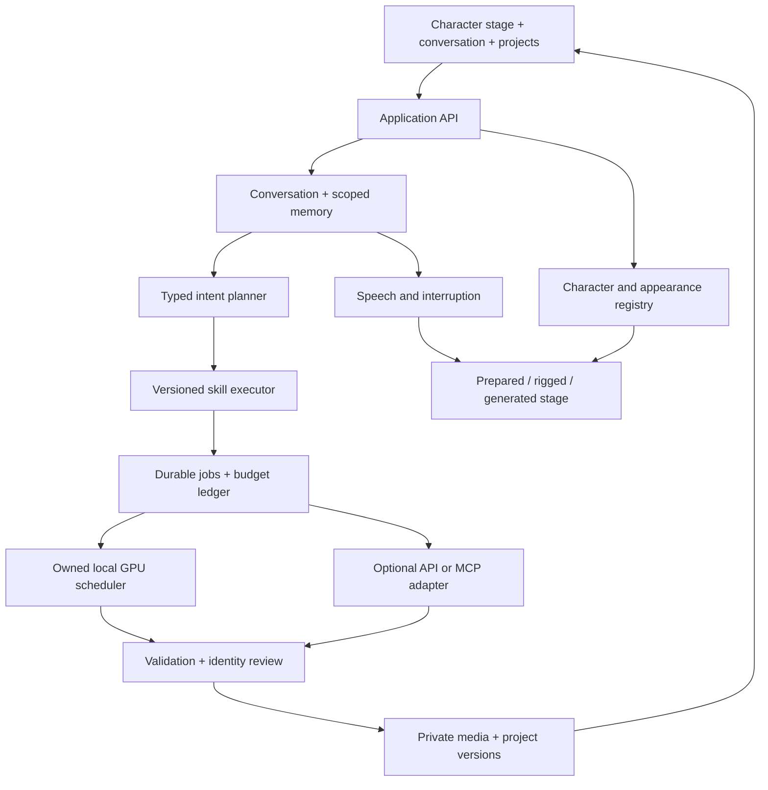

# System architecture and contracts

[Master blueprint](README.md) · New modules and APIs below are proposed.

## Boundaries



Start with a modular Python API and a separate media worker process. Keep the current frontend while extracting manageable JS modules; a framework rewrite is not required. Serve app/assets/APIs on one origin. Hosted operation can later separate API, workers, database and private object storage behind the same contracts.

## Proposed code layout

```text
src/lummings/
  server.py                     current app/compatibility routing
  characters/registry.py        identities, aliases, reference versions
  conversation/service.py      sessions, models, streamed turns
  conversation/memory.py       explicit preferences and deletion
  skills/registry.py           schemas, tool allowlists, step graphs
  skills/executor.py           bounded plans and checkpoints
  media/repository.py          jobs, leases, assets and cost records
  media/worker.py              submit, reconcile, review, publish
  media/providers/             local_comfy, creative_api, optional mcp
  media/scheduler.py           GPU admission and owned resources
  voice/service.py             ASR/TTS and interruption
  projects/service.py          storyboards/worlds/timelines
docs/app/                       evolve the existing UI
brand/characters/               manifests pointing to approved assets
schemas/                        contracts and versions
config/                         non-secret model/provider profiles
data/media/                     ignored DB, quarantine and assets
data/projects/                  ignored project data and exports
```

Add private-data ignore rules before generating output. Do not copy Pixel's database, personal photos, logs or creations. Keep existing Lummings memory/family stores intact until a backed-up migration is tested. Private media never belongs in public docs/GitHub Pages directories.

## Identity and appearance

`CharacterVersion`: canonical ID/version, persona source/hash, model profile, invariant traits, palette, Heartlight, master reference IDs/hashes, permitted changes, voice profile and rights/review status.

`AppearanceVersion`: owner/profile, character version, parent appearance, outfit, references, renderer type and approval state. Apply requires `expectedActiveVersion`; mismatch returns 409. Masters are immutable. Generated candidates cannot promote themselves to canonical references.

Reference pack: front/three-quarter/side views, expression sheet, proportions, signature accessories, three approved looks and style sheet. Reconcile duplicate portrait locations and document authoritative assets. Attach actual reference images to generation; the word “Lumo” in a prompt is insufficient. Consider fine-tuning only after reference-based tests establish a shortfall and training rights are verified.

## Conversation and tools

Keep dedicated Lumming model definitions as selectable server profiles. Verify installation and benchmark behaviour. A shared base model plus persona prompt is a separately tested fallback. Separate character dialogue from schema-constrained planning.

```json
{
  "action": "imagine_scene",
  "characterId": "lumo",
  "appearanceVersion": "appearance_opaque_id",
  "projectId": "project_opaque_id",
  "scene": "a moon garden with a lost star",
  "output": {"kind": "image", "count": 1},
  "followUp": "offer_animate"
}
```

Validate against registered schemas; reject unknown tools, arbitrary URLs and excessive counts. Resolve owner/profile from session, not model output. Executor resolves references, mode and budget before dispatch. Never run model-generated shell/Python/arbitrary ComfyUI graphs. Retrieved content and provider output cannot authorise more actions.

Skills declare version, schemas, tools, max attempts/duration/spend, review and cancellation. Checkpoint each step. Acknowledgements follow accepted intent; success follows persisted accessible media. Summaries describe actual results, not imagined completed actions.

## Proposed API

| Route | Contract |
|---|---|
| GET `/api/v1/capabilities` | Installed/configured/reachable/verified states separately |
| GET `/api/v1/characters` | Reviewed identities and reference versions |
| POST `/api/v1/sessions` | Authorised profile, character, mode and project |
| POST `/api/v1/sessions/{id}/messages` | Client turn ID, text and bounded context |
| GET `/api/v1/sessions/{id}/events` | SSE with monotonic event IDs and resume cursor |
| POST `/api/v1/skills/runs` | Validated skill inputs and idempotency key |
| GET `/api/v1/runs/{id}` | Durable state, job IDs and results; ownership check |
| POST `/api/v1/runs/{id}/cancel` | Stop pending steps; reconcile submitted work |
| POST `/api/v1/media/quotes` | Expiring quote tied to model/settings/input digest |
| POST `/api/v1/creator/jobs/{id}/cancel` | Cancel only before worker submission; releases the reserved budget |
| POST `/api/v1/creator/jobs/{id}/reconcile` | Resolve an uncertain failed-job reservation after checking provider history |
| POST `/api/v1/appearances/{id}/apply` | Approval and active-version comparison |
| GET `/api/v1/assets/{id}` | Authorised approved media, MIME and range support |
| GET/PATCH/DELETE `/api/v1/memories/{id}` | Inspection, correction and summary invalidation |
| POST `/api/v1/projects/{id}/versions` | Versioned storyboard/timeline with conflict checks |
| POST `/api/v1/projects/{id}/export` | Bundle, manifest, captions and lineage |

SSE carries turn/job events; HTTP carries commands; WebRTC or a verified streaming transport carries live audio/video. Keep `/chat` as a compatibility shim during migration. Events contain ID, timestamp, schema version, session/run/job ID, type and payload. Reconnecting never repeats side effects.

### Current local creator-job contract

The first Lummings-native slice adds `GET /api/v1/creator/jobs`, `POST /api/v1/creator/jobs`, `GET /api/v1/creator/jobs/{id}`, `GET /api/v1/creator/jobs/{id}/asset`, `POST /api/v1/creator/jobs/{id}/generate`, `POST /api/v1/creator/jobs/{id}/quote`, `POST /api/v1/creator/jobs/{id}/review`, `POST /api/v1/creator/jobs/{id}/cancel`, and `POST /api/v1/creator/jobs/{id}/reconcile`. Draft creation pins the canonical portrait hash and validates the selected character, wardrobe label, scene and idempotency key. Video drafts must name an accepted image job belonging to the same character and retain its output hash. Results remain in a private generated-media directory and `awaiting_review` until an explicit accept/reject decision. The default server returns `mediaGeneration: false`; the optional server-side fal adapter is enabled only by `LUMMINGS_MEDIA_PROVIDER=fal` plus `FAL_KEY` and a positive `LUMMINGS_MEDIA_DAILY_BUDGET_USD` (default zero). Each generation requires explicit consent, a fresh single-use quote, and sends the canonical reference/prompt to the provider. Quote consumption, budget reservation and queueing are atomic; successful outputs settle the quoted amount; failed ambiguous jobs keep their budget reserved until manual provider-history reconciliation. A queued job can be cancelled before provider submission. Cancellation after remote submission, automated reconciliation, worker leases and actual billed-cost settlement remain open. Restart marks queued/running work failed with a provider-history warning rather than silently resubmitting a possibly billable request.

## Persistence and recovery

Entities: sessions, turns, explicit memories, character/appearance versions, skill runs, jobs, leases, assets/lineage, projects/versions, configuration/consent versions, reservations, settled costs and deletion tombstones. Every private record is owner/profile-scoped. Crew sharing is explicit and project-scoped.

Lifecycle: `draft → awaiting_approval → queued → leased → submitted → running → validating → awaiting_review → completed`. Branches: cancelled, rejected, failed; ambiguous submission becomes reconciling. “Completed” means locally saved and approved for that audience.

Transactionally reserve and enqueue. Unique owner/idempotency-key plus request digest rejects changed retries. Leases expire and heartbeat. Persist submit intent before network dispatch; reconcile lost responses by provider request/idempotency ID. If provider cannot reconcile, hold for manual resolution rather than blindly submit again. Cancellation and billing status are separate.

Persist outputs before completion events, using an outbox/replayable log. Validate download host/address, size/time limits, magic bytes, decoding, dimensions/duration, checksum, content and identity. Quarantine is never directly accessible to family views. Tombstones prevent late jobs restoring deleted data. Purge derivatives/summaries/caches; restore procedures reapply tombstones and disclosed backup retention.

## Pixel transfer boundaries

Adapt queue/idempotency/provider/export concepts and relevant tests from 647cb05. Replace single-workspace ownership and hardcoded identity with Lummings sessions/registry. Do not transplant its robot SVG, dashboard or private data.

Current local `gen-*` jobs have no source image; add and verify reference-conditioned graphs. Replace hardcoded ComfyUI path/port and automatic unloading of resident models with configuration and an owned scheduler. Fix designer issues before reuse: six UI themes exceed three backend options; generated avatar selection is not persisted by Enter; save errors are swallowed. Preserve functionality while addressing these defects explicitly.

## Resource and provider strategy

Initially admit one render at a time. Prioritise chat/voice responsiveness; report queued renders. Unload only service-owned workloads. Offer a bounded reduced-quality option after OOM; do not loop hidden retries. Check model, encoder, node versions, codecs and an actual smoke render—file presence is not readiness.

Adapters declare reference support, image-to-video, audio, cancellation, idempotency, pricing and retention. Local/cloud routing follows explicit settings; never silently upload a failed local request. Pika MCP is optional infrastructure, not the owner of Lummings memory/identity. Discover authenticated schemas and pin reviewed operations.

Live video is a separate adapter/cost budget. Benchmark creature identity, speech sync, mid-call appearance changes, barge-in and reconnect. Keep prepared-stage fallback. Pixel's installed LTX workflow does not establish continuous conversational video capability.
